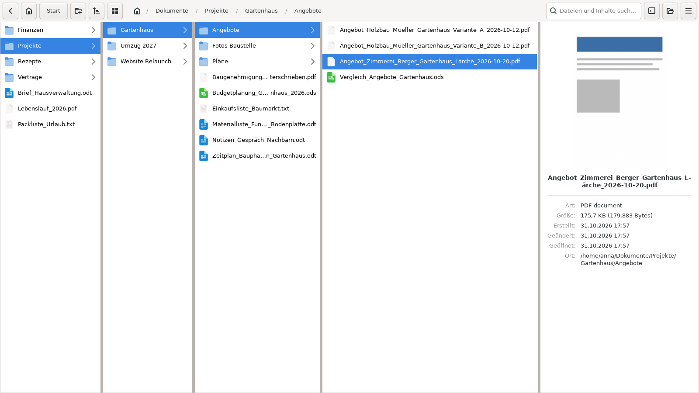
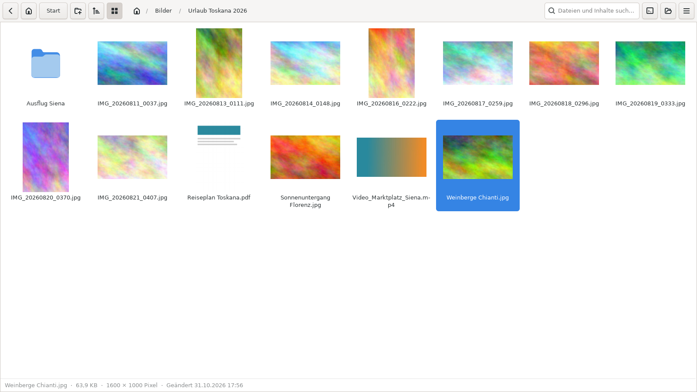

# Nemo Miller Columns



> **Developed by Claude.** This version was written entirely by Claude, an AI model by Anthropic, based on the requirements and testing of [simonsbg-droid](https://github.com/simonsbg-droid). Please keep that in mind when using it, and report problems via *Issues*.

A column view (Miller columns) for Linux Mint / Cinnamon, like the **macOS Finder**: folders open from left to right, one column per level.

*[Deutsche Anleitung](README_DE.md)*

This is an extended fork of [davemin/linux-nemo-miller-columns](https://github.com/davemin/linux-nemo-miller-columns). It adds full keyboard navigation, file operations, drag & drop and many fixes.

## Features

- **Column view**: each folder opens in a new column to the right; scrolls sideways when there are many columns
- **Start folder**: choose the folder that appears in the leftmost column; the **Start** button (or **Esc**) jumps back to it
- **File operations**: copy, cut, paste, rename, new folder, move to trash, delete permanently
- **Clipboard shared with Nemo**: copy in one, paste in the other – both directions
- **Drag & drop**: onto a folder or onto an empty column area; works with Nemo and other apps too
- **Multi-selection** with Ctrl+click and Shift+click
- **Right-click menu** with *Open with* (recommended apps, any other app, set as default)
- **Live updates**: changes made elsewhere (e.g. by a sync client such as ownCloud/Nextcloud) appear automatically
- **Search** by file name and content (text files)
- **Preview in the column view**: to the right of the column you work in, a selected folder shows its contents with a footer (number of items, **folder size**, last change); a selected file shows a preview (image, or the thumbnail of a video or PDF) with type, size, dimensions, created/modified/opened dates and location. Folder sizes are calculated in the background
- **Gallery view** (Ctrl+G or the grid button): a folder's contents as a grid of thumbnails for images, videos and PDFs, with an info bar. Folders that mostly contain pictures or videos open as a gallery automatically (can be switched off in the settings). Thumbnails are shared with Nemo (`~/.cache/thumbnails`); missing ones are created in the background using the system's thumbnailers
- **Sorting** by name, modified date, size or type, ascending or descending, folders first or mixed – via the sort button, the right-click menu on an empty area, or Ctrl+Alt+1–4. One default for all folders, and individual folders can keep their own sorting. Natural order ("Photo 2" before "Photo 10"), accented letters sorted with their base letter
- **Column widths by need**: each column gets as much width as its longest name needs; spare space goes to columns that would otherwise shorten names
- **Extract archives** from the right-click menu: *Extract here* or *Extract to folder* (ZIP and TAR built in, Windows ZIPs with umlauts handled; 7z, RAR and password-protected archives via the Archive Manager)
- **Editable path bar**: Ctrl+L or a click on the empty part of the path bar, with folder completion
- **New folder** button in the toolbar
- **Settings** (menu button ☰ or Ctrl+comma): font size, row spacing (slider from *very tight* to *very loose*), hidden files, start folder, and a slider for column widths from *equal* to *maximum emphasis* – the column you work in gets wider, columns further left get narrower
- Long names are shortened **in the middle**, so the beginning and the file extension stay visible; hover to see the full name
- Double-click a column divider to fit the column to its longest name
- Own app icon; the window title shows the current folder, so several windows are easy to tell apart
- Integrates with Cinnamon: correct panel icon, "New Window" in the panel right-click menu, window snapping (Super+arrows)
- German and English labels in the Nemo context menu



## Keyboard shortcuts

**Navigation**

| Key | Action |
|---|---|
| ↑ / ↓ | Select previous / next item |
| → | Go into the selected folder |
| ← | Back one column |
| Enter | Open file with its default app (folders: like →) |
| Ctrl+O | Open with … (choose an application) |
| Home / End | First / last item in the column |
| Typing letters | Jump to the matching item (press the same letter again to cycle) |
| Backspace / Alt+↑ | One level up |
| Esc | Leave search, otherwise go to the start folder |
| Alt+Home | Home folder |
| Ctrl+L | Edit the path bar (copy or paste a path; Enter opens, Esc cancels) |

**Files**

| Key | Action |
|---|---|
| Ctrl+C / Ctrl+X / Ctrl+V | Copy / cut / paste |
| Delete | Move to trash |
| Shift+Delete | Delete permanently (asks first) |
| Ctrl+U or F2 | Rename |
| Ctrl+Shift+N | New folder |
| Ctrl+A | Select all in the column |
| Menu key / Shift+F10 | Context menu |

**Window**

| Key | Action |
|---|---|
| Ctrl+N | New window |
| Ctrl+W | Close window |
| Ctrl+F | Search |
| F5 | Refresh |
| Ctrl+H | Show / hide hidden files |
| Ctrl+G | Gallery view on / off for this folder |
| Ctrl+Alt+1 / 2 / 3 / 4 | Sort by name / modified / size / type (press again to reverse) |
| Ctrl+Plus / Ctrl+Minus / Ctrl+0 | Larger / smaller / normal font |
| Ctrl+Comma | Settings |

**Mouse**: click selects, double-click opens. Drag moves (on the same drive) or copies (to another drive); hold **Ctrl** to always copy, **Shift** to always move.

When a file already exists you can choose **Skip**, **Keep both** or **Replace**. Replace moves the old version to the trash, so nothing is lost.

## Installation

Requirements: Linux Mint 22 (or another distribution with Nemo 6.x), Python 3, GTK 3, `nemo-python`. The installer installs missing packages for you.

1. Download this repository (green **Code** button → **Download ZIP**) and unpack it, or:
   ```bash
   git clone https://github.com/simonsbg-droid/nemo-miller-columns.git
   ```
2. Open a terminal in the folder and run:
   ```bash
   bash install.sh
   ```
   The installer asks for your start folder. Press Enter to use your home folder.

Everything is installed for the current user only (`~/.local/share`), nothing system-wide except the packages above.

### Usage

- From the menu: **Nemo Miller Columns** (German: **Spaltenansicht**)
- From Nemo: right-click a folder or empty space → **Open in Miller Columns**
- Tip: right-click it in the menu → **Add to panel**, and remove the Nemo panel icon if you want the column view as your default way to open files.

### Change the start folder

Menu button (☰) → **Settings** → *Start folder*.

## Good to know

- **Network locations** (Nemo's "Connect to Server", smb://, sftp://) are not supported. Use the folder button at the top right to open the current folder in regular Nemo.
- **Ctrl+V** pastes into the column you are in, like the Finder. To paste *into* a selected folder, press → first, or right-click it → *Paste into this folder*.
- The column view opens in its own window; it does not replace Nemo's own views.
- The interface of the column view itself is currently in German (the Nemo menu entry follows your system language).

## Uninstall

```bash
bash uninstall.sh
```

## License

MIT – see [LICENSE](LICENSE). Original work © 2024 Davide Minardi.
