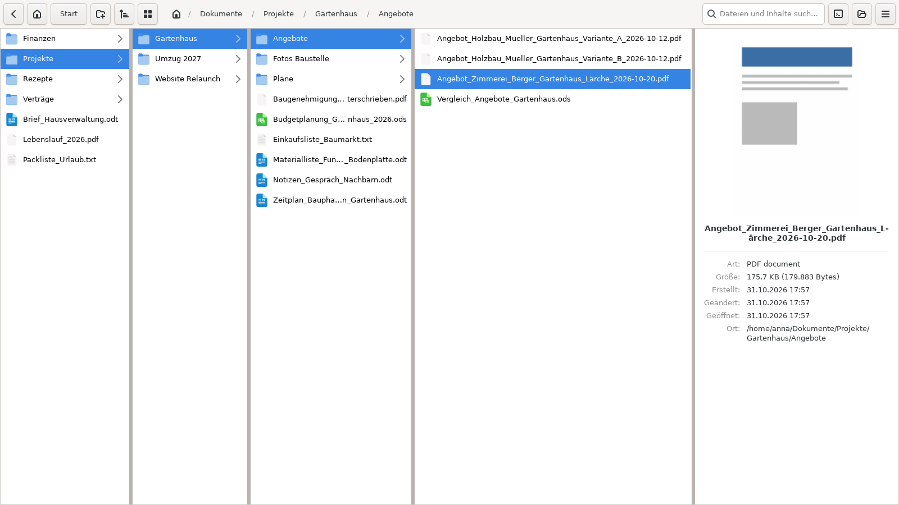
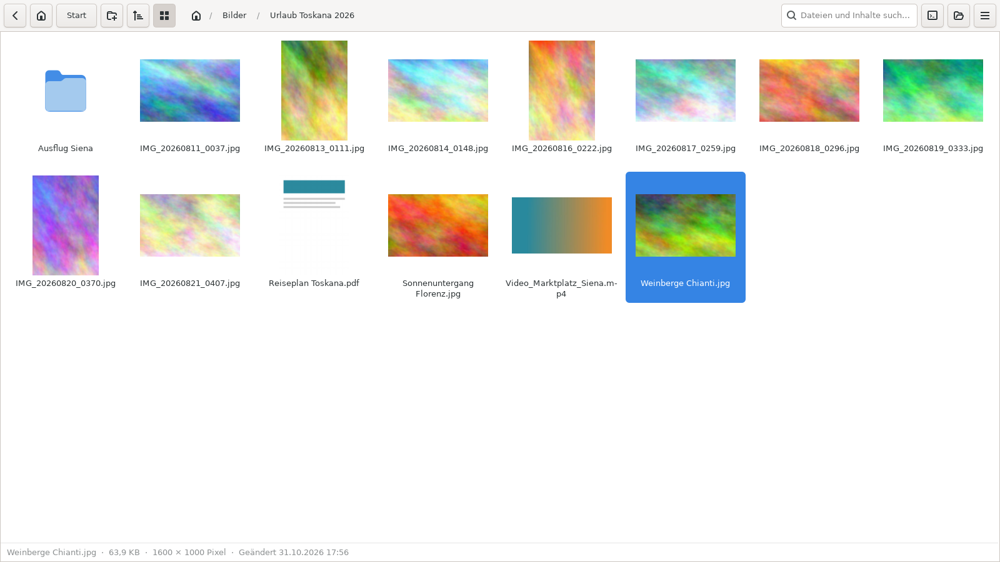

# Nemo Miller Columns – Spaltenansicht



> **Entwickelt durch Claude.** Diese Fassung wurde vollständig von Claude, einem KI-Modell von Anthropic, programmiert – nach den Vorgaben und Tests von [simonsbg-droid](https://github.com/simonsbg-droid). Bitte berücksichtige das bei der Nutzung und melde Probleme über *Issues*.

Eine Spaltenansicht (Miller Columns) für Linux Mint / Cinnamon, wie im **macOS Finder**: Ordner öffnen sich von links nach rechts, eine Spalte pro Ebene.

*[English version](README.md)*

Dies ist eine erweiterte Fassung von [davemin/linux-nemo-miller-columns](https://github.com/davemin/linux-nemo-miller-columns). Neu sind vollständige Tastatursteuerung, Dateioperationen, Drag & Drop und viele Korrekturen.

## Funktionen

- **Spaltenansicht**: jeder Ordner öffnet sich in einer neuen Spalte rechts; bei vielen Spalten scrollt die Ansicht seitlich
- **Startordner**: frei wählbarer Ordner, der ganz links erscheint; der Knopf **Start** (oder **Esc**) springt dorthin zurück
- **Dateioperationen**: kopieren, ausschneiden, einfügen, umbenennen, neuer Ordner, Papierkorb, endgültig löschen
- **Gemeinsame Zwischenablage mit Nemo**: in einem Programm kopieren, im anderen einfügen – in beide Richtungen
- **Drag & Drop**: auf einen Ordner oder eine leere Spaltenfläche; funktioniert auch mit Nemo und anderen Programmen
- **Mehrfachauswahl** mit Strg+Klick und Shift+Klick
- **Rechtsklick-Menü** mit *Öffnen mit* (passende Programme, beliebiges anderes Programm, als Standard festlegen)
- **Automatische Aktualisierung**: Änderungen von aussen (z. B. durch ownCloud/Nextcloud-Sync) erscheinen sofort
- **Suche** nach Dateinamen und Inhalt (Textdateien)
- **Vorschau in der Spaltenansicht**: Rechts neben der Spalte, in der du arbeitest, zeigt ein markierter Ordner seinen Inhalt mit Fusszeile (Anzahl, **Ordnergröße**, letzte Änderung); eine markierte Datei zeigt eine Vorschau (Bild bzw. Vorschaubild von Video oder PDF) mit Art, Größe, Abmessungen, Erstellt/Geändert/Geöffnet und Ort. Ordnergrößen werden im Hintergrund berechnet
- **Galerie-Ansicht** (Strg+G oder Raster-Knopf): Ordnerinhalt als Raster aus Vorschaubildern für Bilder, Videos und PDFs, mit Infozeile. Ordner, die überwiegend Bilder oder Videos enthalten, öffnen sich automatisch als Galerie (abschaltbar). Vorschaubilder werden mit Nemo geteilt (`~/.cache/thumbnails`); fehlende entstehen im Hintergrund mit den Vorschau-Werkzeugen des Systems
- **Sortierung** nach Name, Änderungsdatum, Größe oder Art, auf- oder absteigend, Ordner zuerst oder gemischt – über den Sortieren-Knopf, das Rechtsklick-Menü auf einer leeren Fläche oder Strg+Alt+1–4. Ein Standard für alle Ordner, einzelne Ordner können ihre eigene Sortierung behalten. Natürliche Reihenfolge („Foto 2“ vor „Foto 10“), Umlaute bei ihrem Grundbuchstaben
- **Spaltenbreite nach Bedarf**: Jede Spalte bekommt so viel Breite, wie ihr längster Name braucht; freier Platz geht an Spalten, die sonst kürzen müssten
- **Archive entpacken** per Rechtsklick: *Hier entpacken* oder *In Ordner entpacken* (ZIP und TAR eingebaut, Windows-ZIPs mit Umlauten werden richtig gelesen; 7z, RAR und passwortgeschützte Archive über die Archivverwaltung)
- **Bearbeitbare Pfadleiste**: Strg+L oder Klick auf die freie Fläche der Pfadleiste, mit Ordner-Vervollständigung
- **Neuer-Ordner-Knopf** in der Werkzeugleiste
- **Einstellungen** (Menü-Knopf ☰ oder Strg+Komma): Schriftgröße, Zeilenabstand (Schieberegler von *sehr eng* bis *sehr locker*), versteckte Dateien, Startordner und ein Schieberegler für die Spaltenbreite von *gleich breit* bis *maximal betont* – die Spalte, in der du arbeitest, wird breiter, Spalten weiter links schmaler
- Lange Namen werden **in der Mitte gekürzt**, Anfang und Dateiendung bleiben sichtbar; mit der Maus darüber erscheint der volle Name
- Doppelklick auf eine Trennlinie passt die Spalte an den längsten Namen an
- Eigenes Programmsymbol; der Fenstertitel zeigt den aktuellen Ordner, so lassen sich mehrere Fenster gut unterscheiden
- Fügt sich in Cinnamon ein: richtiges Panel-Symbol, „Neues Fenster“ im Rechtsklick auf das Panel, Andocken mit Super+Pfeiltasten



## Tastenkürzel

**Navigation**

| Taste | Funktion |
|---|---|
| ↑ / ↓ | Vorheriger / nächster Eintrag |
| → | In den markierten Ordner hinein |
| ← | Eine Spalte zurück |
| Enter | Datei mit dem Standardprogramm öffnen (bei Ordnern wie →) |
| Strg+O | Öffnen mit … (Programm auswählen) |
| Pos1 / Ende | Erster / letzter Eintrag der Spalte |
| Buchstaben tippen | Springt zum passenden Eintrag (gleicher Buchstabe nochmal: weiterblättern) |
| Rücktaste / Alt+↑ | Eine Ebene hoch |
| Esc | Suche beenden, sonst zum Startordner |
| Alt+Pos1 | Persönlicher Ordner |
| Strg+L | Pfadleiste bearbeiten (Pfad kopieren oder einfügen; Enter öffnet, Esc bricht ab) |

**Dateien**

| Taste | Funktion |
|---|---|
| Strg+C / Strg+X / Strg+V | Kopieren / Ausschneiden / Einfügen |
| Entf | In den Papierkorb |
| Shift+Entf | Endgültig löschen (mit Rückfrage) |
| Strg+U oder F2 | Umbenennen |
| Strg+Shift+N | Neuer Ordner |
| Strg+A | Alles in der Spalte markieren |
| Menütaste / Shift+F10 | Kontextmenü |

**Fenster**

| Taste | Funktion |
|---|---|
| Strg+N | Neues Fenster |
| Strg+W | Fenster schliessen |
| Strg+F | Suchen |
| F5 | Aktualisieren |
| Strg+H | Versteckte Dateien ein/aus |
| Strg+G | Galerie-Ansicht für diesen Ordner ein/aus |
| Strg+Alt+1 / 2 / 3 / 4 | Sortieren nach Name / Geändert / Größe / Art (nochmal: Richtung umkehren) |
| Strg+Plus / Strg+Minus / Strg+0 | Schrift größer / kleiner / normal |
| Strg+Komma | Einstellungen |

**Maus**: Klick markiert, Doppelklick öffnet. Ziehen verschiebt (gleiches Laufwerk) bzw. kopiert (anderes Laufwerk); mit **Strg** wird immer kopiert, mit **Shift** immer verschoben.

Gibt es eine Datei schon, kannst du **Überspringen**, **Beide behalten** oder **Ersetzen** wählen. Ersetzen legt die alte Version in den Papierkorb, damit nichts verloren geht.

## Installation

Voraussetzungen: Linux Mint 22 (oder eine andere Distribution mit Nemo 6.x), Python 3, GTK 3, `nemo-python`. Fehlende Pakete installiert das Skript selbst.

1. Dieses Projekt herunterladen (grüner Knopf **Code** → **Download ZIP**) und entpacken, oder:
   ```bash
   git clone https://github.com/simonsbg-droid/nemo-miller-columns.git
   ```
2. Im Ordner ein Terminal öffnen und ausführen:
   ```bash
   bash install.sh
   ```
   Das Skript fragt nach dem Startordner. Enter übernimmt den persönlichen Ordner.

Alles wird nur für den aktuellen Benutzer installiert (`~/.local/share`), systemweit kommen nur die genannten Pakete dazu.

### Benutzung

- Über das Startmenü: **Spaltenansicht**
- Aus Nemo: Rechtsklick auf einen Ordner oder eine leere Fläche → **In Spaltenansicht öffnen**
- Tipp: Im Startmenü Rechtsklick → **Zum Panel hinzufügen**, und das Nemo-Symbol aus dem Panel entfernen, wenn die Spaltenansicht dein Standard sein soll.

### Startordner ändern

Menü-Knopf (☰) → **Einstellungen** → *Startordner*.

## Gut zu wissen

- **Netzwerkorte** (Nemos „Mit Server verbinden“, smb://, sftp://) werden nicht unterstützt. Der Ordner-Knopf oben rechts öffnet den aktuellen Ordner im normalen Nemo.
- **Strg+V** fügt in die Spalte ein, in der du gerade bist, wie im Finder. Um *in* einen markierten Ordner einzufügen, zuerst → drücken oder Rechtsklick → *In diesen Ordner einfügen*.
- Die Spaltenansicht öffnet sich in einem eigenen Fenster und ersetzt Nemo nicht.

## Deinstallation

```bash
bash uninstall.sh
```

## Lizenz

MIT – siehe [LICENSE](LICENSE). Ursprüngliches Werk © 2024 Davide Minardi.
